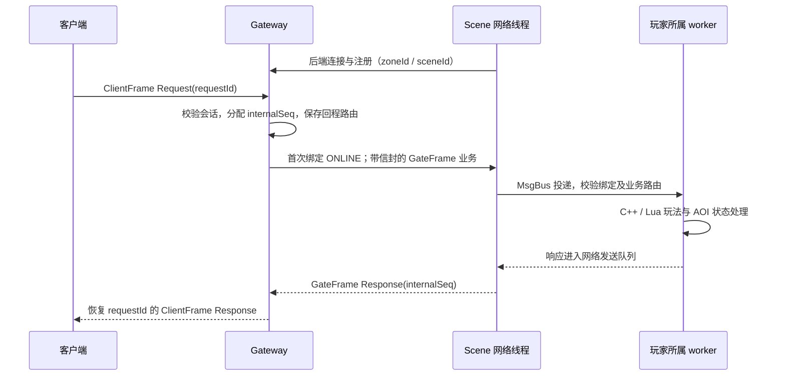

# GameServer

[](https://en.cppreference.com/w/cpp/20)
[](https://developers.google.com/protocol-buffers)
[](https://www.lua.org/manual/)
[](https://cmake.org/documentation/)
[](https://docs.python.org/3/)
[](https://www.gnu.org/software/bash/manual/)

构建使用 CMake，玩法脚本使用 Lua；Python 3 和 Bash 用于测试与诊断脚本。数据库通道及持久化验收所需的额外依赖见[构建说明](#各子服务器的构建命令)。

使用 C++20、Lua 和 Protobuf 开发的分区分服服务端

## 项目简介

本项目采用分区分服服务端架构，按区服组织服务。区服内部：网关负责客户端接入和请求路由，场景服处理玩家状态、Lua 玩法、AOI 与存档，聊天服提供区服内私聊和喊话。Global 目前只提供 Ping/Echo，LoginServer 尚未实现。

本文介绍顶层设计、模块分工、构建方法和已有测试结果。服务配置、协议处理和内部实现见**文档导航**

## 文档导航

| 文档                                                                      | 维护范围                           |
| ------------------------------------------------------------------------- | ---------------------------------- |
| [Gateway](Zone/gatewayServer/README.md)                                   | 接入、会话、路由、配置与运行       |
| [Scene](Zone/sceneServer/README.md)                                       | worker、Lua、AOI、持久化与运行     |
| [Chat](Zone/chatServer/README.md) / [Global](Zone/globalServer/README.md) | 当前业务与职责限制                 |
| [线协议](Zone/PROTOCOL.md)                                                | ClientFrame / GateFrame 与业务消息 |
| [监测模块](Zone/sceneServer/src-cpp/metrics/README.md)                    | 指标、诊断和调度策略               |
| [持久化验收](Zone/sceneServer/tests/PERSISTENCE_ACCEPTANCE.md)            | 隔离数据库验证方法与历史结果       |

文档中的文件链接只指向仓库提供的内容。构建示例从仓库根目录执行，`out/zone` 是由 CMake 新生成的目录，不是预先提供的测试文件。

## 目录
- [文档导航](#文档导航)
- [顶层设计](#顶层设计)
    - [各个模块的核心设计思路](#各个模块的核心设计思路)
        - [网关](#网关)
        - [场景服](#场景服)
- [子模块职责与边界](#子模块职责与边界)
    - [网关](#网关)
    - [场景服务器](#场景服务器)
    - [一次场景请求](#一次场景请求)
    - [区服拓扑](#区服拓扑)
- [各子服务器的构建命令](#各子服务器的构建命令)
    - [Gateway](#gateway)
    - [Scene](#scene)
    - [Chat](#chat)
    - [Global](#global)
- [测试数据](#测试数据)
    - [3G2S 移动测试](#3g2s-移动测试)

## 顶层设计

整体流程概述：
- A:客户端首先连接登录服进行登录/注册，得到所有区服ip地址和自身账号相关信息后连接到对于区服的网关集群
- B:连接到网关集群后**客户端主动发送鉴权消息**，网关根据鉴权结果对客户端连接进行绑定
- C:**鉴权后**的客户端可以**发送普通业务消息**：如移动等，**网关解析客户端消息帧**后将其中的消息体**打包成网关帧**并生成对应**回程路由**后**转发**给目标后端服务器
- D:后端服务器完成处理时再投递给对应网关，对应网关解包数据后再根据回程路由信息生成客户端帧并回投结果
  
一言概之：客户端连接所选区服的网关，后端服务主动连接网关并注册。网关转发请求，场景服按玩家所属 worker 执行玩法，再经网关返回响应
  
整体流程示意图如下
```text
客户端 ┄┄> LoginServer（待实现：账号认证、登录凭证、区服列表与角色归属查询）
  │
  │ ClientFrame：客户端主动连接所选区服的网关
  ▼
┌────────────────────── 一个 Zone（zoneId）──────────────────────┐
│ Gateway 1 … Gateway G                                         │
│     ▲ GateFrame：后端主动连接，网关经该连接转发业务              │
│     ├── Scene 1 … Scene S：玩法、玩家状态、地图与 AOI           │
│     ├── Chat：同一区服跨网关私聊与喊话                          │
│     └── Global：当前仅 Ping/Echo 接入验证                      │
│                                                               │
│ Scene 内部：网络线程 ↔ MsgBus ↔ 逻辑 worker / Lua / AOI        │
│                            ↔ DB、定时器等辅助线程              │
│ Scene 数据通道：MySQL（角色/快照）、Redis（按区服隔离的键）      │
└──────────────────────────────────────────────────────────────┘
```

图中的 LoginServer 是规划中的服务，负责账号认证、登录凭证、区服列表和角色归属查询。当前网关只有开发期鉴权，尚未接入正式登录和入区鉴权。

### 各个模块的核心设计思路
本段介绍各个服务器的设计思路、实现细节

#### 网关
>前提：本设计中网关与后端服务器采用socket通信，若想在不同机器上进行通信时也可以基于etcd实现服务注册与服务发现；若网关集群与后端服务器位于一台机器上也可以采用共享内存等其他多进程通信机制通信

网关主要基于**主从Reactor** + **One Loop per Thread**模型实现
- 主Reactor: 负责内外网双监听——两个不同身份的连接器，有新连接就调用连接器生成新TcpConnection并将其轮询到一个从Reactor上
    - 对外可以使用地址和端口复用，多个网关监听同一个"addr:port"
    - 对内可以监听同一地址的不同端口,这可以实现每个网关都持有一定数量的与每一个后端服务器的连接
- 从Reactor：负责监听其线程上的所有连接，对每个连接根据其身份调用不同的分发函数

*选用这种模型的初衷是：网关一般要建立大量连接并关注其上的网络事件，若将所有连接丢给一个线程处理时，轮询将是一个很大的开销。采用主从Reactor管理的话，各个线程CPU可以腾出更多时间在处理消息上。跨线程任务投递可以通过取对应线程的loop并由其runInLoop函数在对应IO线程中运行以确保线程安全*

不同网关的gatewayId不同，后端服务器据此区服同一网关集群的不同网关实例

#### 场景服
场景服主要基于**Actor** 模型实现，内部分Net、LogicThread、DB、Timer四个不同的模块；各个模块之间通过MsgBus互相投递消息实现跨线程通信

- Net: 负责对外进行消息收发，由于大部分客户端连接负载都在网关上，所以后端服务器连接规模一般较小，故该层只有单个线程
    - **反向连接网关**并发送握手协议来**上报自己身份**，对同一网关实例建立一定数量的连接
    - 接收到网关传来的业务消息则将其解码并封装成场景服内部的同一消息格式Msg,经由MsgBus投递到对应逻辑线程
    - 当其持有的MPSC队列有待发送数据时，解析Msg并根据其中消息封装网关帧并回投对应网关
- LogicThread: 负责处理其管理的玩家的业务事件、定期推送其管理的玩家的状态等,每一个逻辑线程都持有一个MPSC队列、一个Lua VM 和一个PlayerManager等，线程**内部消息串行处理**以实现无锁
    - **Lua VM**：一个线程一个且不可跨线程访问其他线程的Lua VM，这保证Lua VM的线程安全；场景服的权威状态保存在C++中，Lua脚本仅负责玩法，所以仅需要在线程安全时即可实现热更；当前调用lua脚本是以pcall的形式调用，若引入Lua协程则需要等协程处理完毕再进行热更。
    - **PlayerManager**: 每个逻辑线程都持有本线程管理的玩家的权威状态并持有其他线程玩家的状态副本，本线程玩家状态改变时打上脏标记并定期落盘玩家数据——若有重要数据改变则立刻落盘
    - **AOI**：本线程玩家的事件立刻处理，处理完成后回包并生成Msg通过MsgBus广播给其他线程，其他线程玩家投递的远端事件则分情况：EntryScene、LeaveScene事件立刻处理，Move则幂等保留最新事件版本后在Tick()中应用；AOI视野则增量更新——取当前AOI视野和上次推送的视野进行比较
- DB：负责与数据库进行交互，**支持事务和单语句任务**；单线程无锁
- Timer：负责整个场景服的定时任务，一般由Lua脚本创建定时器；基于256槽时间轮实现；单线程无锁

各个线程之间通过往对方私有队列中投递消息的方式实现通信使得线程之间基本不会产生跨线程访问数据带来的数据竞争问题，但是于此同时会产生一些新问题——也可以说是代价：
1. **消息处理不同步**：将事件封装成消息投递到对方消息队列的方式为异步处理，消息的处理存在一定延迟；
2. **频繁构造和析构Msg会带来一定的系统调用开销**——可以实现内存池来减少系统调用次数或者引入移动语义来减少拷贝次数

玩家权威状态保存在C++并由各个线程分别管理一定玩家权威状态也会带来一些代价
1. **其他线程修改数据并投递的通知事件存在延迟**；
2. **玩家AOI视野同步带来的存储成本较大**：每个线程保存全场景其他玩家的轻量状态副本，本线程客户端事件的应用结果需要投递到其他线程 ——这也是本项目测试万级并发时遇到的P0问题

#### 聊天服务器


#### 全局服务器


>网关和场景服的代价是当前已知的，未遇到且未查明的问题并未列出

## 子模块职责与边界

网关管理连接和会话，Scene 管理玩家状态，Chat 和 Global 各自处理登记的业务。数据库与定时器是 Scene 的辅助线程，不直接处理客户端连接。

| 模块 | 负责 | 不负责或尚未实现 |
| --- | --- | --- |
| Gateway | 客户端接入、会话、服务注册、请求和推送转发 | 玩法、玩家数据库、正式账号认证、自动故障接管 |
| Scene | 玩家状态、Lua 玩法、地图、AOI、异步存档 | 公网接入、正式登录、跨进程场景迁移 |
| Chat | 同一区服内跨网关私聊和喊话 | 离线消息、可靠送达确认、管理员广播、跨区聊天 |
| Global | Ping/Echo 接入验证 | 公会、排行榜及其他全区业务 |
| LoginServer（待实现） | 规划负责账号认证、登录凭证、区服列表和角色归属查询 | 当前未接入正式登录流程 |

### 网关

Gateway 管理接入、会话与路由，业务载荷交给后端处理。
- 客户端和后端分别使用独立监听入口及 `ClientFrame`、`GateFrame` 协议，不能混用
- 维护客户端会话、可信玩家身份、服务注册、场景/通道绑定和有界回程路由，不执行玩法或直接访问玩家数据库
- 后端注册包含服务及区服身份；多 Scene 按 `sceneId` 区分。会话选定具体场景通道后保持绑定，不提供自动迁移或故障接管
- 转发时分配内部 `seq`，保存客户端 `requestId` 与会话；响应校验来源和身份后恢复客户端请求号。后端推送由网关筛选本地会话并投递
- 场景业务携带版本化玩家绑定信封。首次声明先提交 ONLINE，稳定绑定后只提交带信封的业务帧；退出发送精确 OFFLINE。声明仅表示交给本地发送路径，不代表场景服已应用

### 场景服务器

Scene 按 worker 划分玩家状态，通过消息总线与网络、数据库和其他 worker 协作。
- 不直接接收客户端连接；网络线程维护网关连接与玩家绑定索引，通过进程内 `MsgBus` 投递到所属逻辑 worker。
- 每个 worker 独占玩家对象、Lua VM、持久化协调器和 AOI 状态；C++ 管理生命周期和基础校验，Lua 承载移动等示例玩法。worker 之间传事件与快照，不共享可变 Player。
- 同一 Scene 进程内通过消息总线同步跨 worker AOI 副本与恢复快照。观察者处理生成视野推送，经网络队列和网关返回；本地队列接受不等于客户端收到。
- DB 线程异步执行 MySQL/Redis 任务，结果回投原 worker。保存使用固定快照、版本校验、去重和 ACK；账本在内存中，不提供崩溃后任务恢复或未知 COMMIT 结果自动对账。
- `PendingDbTasks` 活跃索引只调度仍需处理的任务，保留历史身份及重复结果语义；它是维护成本优化，不等于提高了已测最大吞吐容量。

### 一次场景请求
下图从网关已有鉴权会话开始，不包含尚未实现的正式登录流程。



### 区服拓扑

同一区服可以部署多个网关和场景实例；不同区服的数据隔离和跨区业务需要单独设计。

| 层级                       | 当前关系与边界                                                                                                                         |
| -------------------------- | -------------------------------------------------------------------------------------------------------------------------------------- |
| 一个 Zone 内的多个 Gateway | 汇聚各自客户端；后端按配置连接网关。网关不自动共享完整在线会话表。                                                                     |
| 一个 Zone 内的多个 Scene   | 网关按场景与通道绑定路由；跨 worker AOI 只在同一 Scene 进程内同步，不是跨 Scene 迁移。                                                 |
| Chat 与多个 Gateway        | Chat 连接同一区服已配置网关，私聊/喊话向网关扇出，各网关筛选本地会话；没有离线消息或可靠送达确认。                                     |
| Global                     | 当前只连接一个网关，且只提供 Ping/Echo；其他功能待后续完善                                                                             |
| 不同 Zone                  | 以 `zoneId` 区分注册与数据命名空间；Redis 键使用 `zone:{zoneId}:...`。MySQL 的库、账号及部署隔离需单独配置，不能仅靠 zoneId 自动保证。 |
| 跨区服业务                 | 当前没有跨区聊天、跨区 AOI、角色迁移或统一跨区业务总线。LoginServer 待实现，职责包括提供区服列表与角色归属查询。                       |

同一区服增加 Gateway/Scene 是横向部署，不等于不同区服已经互通。MySQL/Redis 是数据通道，不是已实现的跨区实时消息总线。

## 各子服务器的构建命令

所有命令从仓库根目录执行。需要支持 C++20 的编译器、CMake 3.20 或更新版本、Protobuf 编译器与开发库，以及 Lua 5.4/5.3 开发库。统一工程在配置时也会检查 Scene 的依赖，即使只构建网关也需要 Lua。

MySQL/MariaDB Connector/C 和 valkey/hiredis 开发库用于数据库通道。缺少它们时，CMake 会禁用对应通道；运行持久化功能还需要可访问的数据库服务。

先生成 Release 构建配置；`out/zone` 由 CMake 创建：

```bash
cmake -S Zone -B out/zone -DCMAKE_BUILD_TYPE=Release -DSCENE_BUILD_TESTS=ON
```

再按需构建服务器：

### Gateway

```bash
cmake --build out/zone --target gatewayServer -j 2
```

### Scene

```bash
cmake --build out/zone --target sceneServer -j 2
```

### Chat

```bash
cmake --build out/zone --target chatServer -j 2
```

### Global

```bash
cmake --build out/zone --target globalServer -j 2
```

可执行文件生成在 `out/zone/bin`。先启动网关，再启动后端；各服务器的工作目录、配置参数和测试入口见各自 README。

## 测试数据

本节分两部分：**单网关/单场景基准** 与 **历史 3G2S 记录**

### 单网关 / 单场景基准

环境：WSL2、AMD 7745HX（8 物理核 / 16 逻辑核）、16 GiB 内存、**无 Swap**；服务与压测客户端**同机**、走 loopback；DB 通道关闭。

配置：1 个 Gateway（4 客户端 IO 线程 + 2 后端 IO 线程）、1 个 Scene（4 逻辑线程 + 2 网络分片）、每网关 4 条后端通道、AOI `tickMs=100`、分散出生点（间距 100）、2000×2000 地图

| 组 | 连接 × RPS × 时长 | 目标请求 | 实际发送 | 业务失败 | 网关拒绝 | 未知响应 | 请求超时 | 登出 | p50 | p95 | p99 |
|---|---|---:|---:|---:|---:|---:|---:|---:|---:|---:|---:|
| 千级 | 1,000 × 10 × 30s | 300,000 | 298,000（99.3%） | **0** | **0** | **0** | **0** | 1,000/1,000 | 8.7 ms | 16.4 ms | **21.5 ms** |
| 万级 | 10,000 × 1 × 40s | 400,000 | 398,128（99.5%） | **0** | **0** | **0** | 104（0.03%） | 9,656/10,000 | 103.9 ms | 170.8 ms | **203.8 ms** |

**解释**：

- **同样 10,000 RPS**，1,000 连接 p99 **21.5 ms**、10,000 连接 p99 **203.8 ms** —— 成本由"连接数 × 每连接 AOI 推送帧"驱动，而不是 RPS 本身
- **千级达标**（p99 ≤ 100 ms、零失败零超时），默认 `tickMs=50` 下同样达标
- **万级 p99 未达标**（203.8 ms）：测量时服务端并未饱和（worker 忙碌度 13~16%、worker 队列 0、三进程合计约 4.7/16 核），且压测客户端与服务同机竞争 loopback/L3，需在独立压测机复测
- 口径：只统计正式窗口内的成功响应（不含 drain）；p99 含 drain 期样本；均为端到端指标——客户端发出 → 收到响应


**长时（120s）**：同一拓扑，10,000 连接分别以 1 RPS / 5 RPS 持续 120 秒

| 组 | 连接 × RPS × 时长 | 目标请求 | 实际发送 | 业务失败 | 请求超时 | 登出 | p50 | p95 | p99 |
|---|---|---:|---:|---:|---:|---:|---:|---:|---:|
| 长时 1 RPS | 10,000 × 1 × 120s | 1,200,000 | 1,052,919（87.7%） | 3,911（0.37%） | 1,997 | 7,890/10,000 | 163.7 ms | 375.5 ms | **488.8 ms** |
| 长时 5 RPS | 10,000 × 5 × 120s | 6,000,000 | 2,289,461（38.2%） | 159,064（7.0%） | 7,605 | 2,395/10,000 | 117.8 ms | 518.6 ms | **996.7 ms** |

- **长时 1 RPS**：无内存增长（Scene RSS 67 MB）、无定时器溢出、后端断链 4 次全部自愈；但 `sendToWorker queue full` 仍有 5,160 次，登出成功率降到 78.9%，p99 为 488.8 ms
- **长时 5 RPS（目标 50,000 RPS）**：**明显超出当前容量** —— 供给仅 38.2%、业务失败 7.0%、p99 ≈ 1 s、登出 24%；`sendToWorker queue full` 17.7 万次，逻辑 worker 与推送侧同时饱和
- 两轮长测均未出现 RSS 持续增长；剩余瓶颈仍是"每连接每 tick 一帧"的推送模型与逻辑 worker 队列

**容量阶梯（10,000 连接 × 120s，每连接 RPS 递增）**

| 每连接 RPS | 需求 RPS | 实测吞吐 | 业务失败率 | 登出 | p99 |
|---:|---:|---:|---:|---:|---:|
| 1 | 10,000 | **8,774** | 0.37% | 78.9% | 488.8 ms |
| 2 | 20,000 | **12,460** | 4.68% | 49.3% | 1,572.1 ms |
| 3 | 30,000 | **18,110** | 4.59% | 50.1% | 889.4 ms |
| 5 | 50,000 | **19,079** | 6.95% | 24.0% | 996.7 ms |

- **拐点在需求 10k~20k RPS 之间（每连接 1~2 RPS）**：失败率 0.37% → 4.68%，登出 78.9% → 49.3%
- **可持续吞吐 ≈ 9,000 RPS**（120s）；**40s 窗口可支撑 10,000 RPS**（零失败）
- **实测吞吐上限 ≈ 18,000~19,000 RPS**，但此时失败 4.6%~7.0%、登出仅 24%~50%
- 读数注意：p99 跨档不单调（2 RPS 1,572 ms > 3 RPS 889 ms），因为高需求档有大量请求被快速拒绝；跨档比较应看"失败率 + 登出完成率"

### 历史记录：3G2S 移动测试

> **注意**：以下为历史记录，客户端为"每连接一线程"的旧实现、配置与当前不同

**512 连接时，两个 Scene 合计约 1.535 万成功 RPS。60 秒测试零错误通过；600 秒出现 busy**

测试使用 3 个 Gateway 和 2 个 Scene（3G2S），服务、数据库和客户端在同一台机器运行。具体设置：

- Release 构建，每个 Scene 4 个 worker。
- 开启 AOI 和持久化，每秒保存一次。
- 使用事件驱动改造前的旧客户端（即每个客户端连接各分配一个线程），每个连接收到响应后才发送下一条 Walk 请求。

| 归档轮次                             | 连接与供给目标            | 正式窗口 | 成功 RPS  | p99       | 业务错误 / unresolved         | 严格结果 |
| ------------------------------------ | ------------------------- | -------- | ---------:| ---------:| ----------------------------- | -------- |
| 2026-10-20：事件驱动改造前的旧客户端 | 512 × 30 RPS = 15,360 RPS | 60 秒    | 15,358.83 | 96.772 ms | 0 / 0                         | 通过     |
| 2026-10-20：事件驱动改造前的旧客户端 | 512 × 30 RPS = 15,360 RPS | 600 秒   | 15,353.17 | 94.335 ms | 605 次 `1011:server busy` / 0 | 未通过   |

成功 RPS 只统计正式窗口内的客户端成功响应，不含 drain（停止发请求后的排空阶段）。p99 使用三个客户端合并的成功响应样本，包含排空时收到的响应。两项都是端到端指标，不是内部 handled 消息数或单 Scene 吞吐。

600 秒测试有两个明显问题：

| 问题               | 观测                                                                     |
| ------------------ | ------------------------------------------------------------------------ |
| 发请求不均匀       | 最大发送调度滞后约 28.23 秒，每分钟吞吐有波动                            |
| Scene 内存持续增长 | Scene 1 RSS：29.29 → 157.84 MiB；Scene 2：29.34 → 146.34 MiB，未趋于平稳 |

保存与退出检查：两次测试的 512 名玩家都成功登出，两个 Scene 正常退出。请求计数与延迟样本数核对一致，所有受测玩家的在线保存版本都有推进。但没有逐人核对最终坐标，也没有检查背包一致性和重登恢复。

该轮内存增长原因未确定；当轮的压测客户端形态与同机部署会显著影响尾延迟


